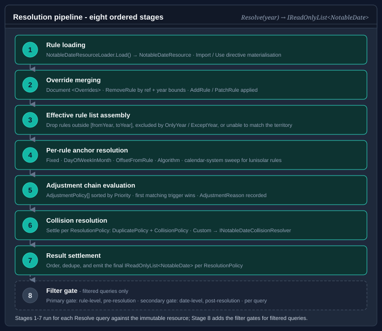

# The resolution pipeline

This page walks through every stage the calendar engine runs - first the **load** stages that turn an authored document into an immutable <xref:Bodu.Globalization.Calendar.NotableDateResource>, then the **query** stages a <xref:Bodu.Globalization.Calendar.NotableDateService> runs to turn that resource into an `IReadOnlyList<NotableDate>`. Understanding the pipeline helps diagnose why a date appears, does not appear, or was shifted from its expected position.

For the vocabulary used below (document vs. resource, rule vs. resolved date, nominal vs. observed) see [Core concepts](../../docs/calendar/concepts.md).

---

## Pipeline overview



Loading happens once, when the resource is built; querying happens per request:

```
NotableDateResourceLoader.Load(xml[, resolver][, algorithms])
   parse → resolve <Imports> → apply <Overrides> → assemble → validate
      → immutable NotableDateResource
NotableDateService.Resolve(date | range | year, territory[, filter])
   strategy → nominal date → adjustment policies → observed date
      → duplicate/collision settlement → emission → NotableDate set
```

---

## Load stages

The loader (<xref:Bodu.Globalization.Calendar.NotableDateResourceLoader>) takes the document text, an optional `Func<string,string?>` resolver used to fetch imported catalogues by name, and an optional <xref:Bodu.Globalization.Calendar.Algorithms.INotableDateAlgorithmRegistry> that whitelists custom `<Algorithm key>` values during validation.

```csharp
using Bodu.Globalization.Calendar;

NotableDateResource resource = NotableDateResourceLoader.Load(
    documentXml,
    CommonNotableDateResources.Resolver);   // resolves <Import resource="global-core"> etc.
```

### Stage 1 - Parse

The document (XML on the `urn:bodu:globalization:calendar` namespace, or JSON via `LoadJson`) is parsed into its in-memory shape: a `<Metadata>` block, the resource-level `<ResolutionPolicy>`, the top-level `<AdjustmentPolicies>`, the `<Imports>`, the `<NotableDates>`, and the `<Overrides>`. Malformed input throws `FormatException` (or `ArgumentException` / `ArgumentNullException` for bad arguments) before any semantic work.

### Stage 2 - Resolve `<Imports>`

Each `<Import resource="…">` names a catalogue. The loader calls the supplied resolver with that name to obtain the imported document text and recursively loads it. An `<Import>` with no `<Use>` child imports every concept from the catalogue; `<Use notableDateRef="…">` cherry-picks a single concept and can rename it (`as`), re-scope it to a territory, override its category or non-working flag, and attach `<Adjustments>`. **Local concepts win over imported concepts of the same id**, so a document can import a baseline and selectively replace pieces of it.

The bundled catalogues are resolved through <xref:Bodu.Globalization.Calendar.CommonNotableDateResources> (`Resolver` / `Resolve(name)`) - `global-core`, `christian-western`, `global-islamic`, `global-hindu`, and friends.

### Stage 3 - Apply `<Overrides>`

ID-targeted edits in `<Overrides>` are applied to the assembled-but-not-yet-finalised concept set:

- `<AddRule notableDateRef="…">` appends a new `<Rule>` to an existing concept.
- `<PatchRule notableDateRef="…" ruleRef="…">` replaces scalar attributes (`priority`, `category`, `nonWorking`, `durationDays`, `comment`) and, when supplied, the `<Applicability>`, `<Strategy>`, `<Tags>`, or `<Adjustments>` of an existing rule.
- `<RemoveRule notableDateRef="…" ruleRef="…">` deletes a rule.

Overrides let a regional document tweak imported concepts without forking them. See [Authoring notable date rules](rule-authoring.md) for the full override vocabulary.

### Stage 4 - Assemble

The imported, overridden concepts are flattened into the immutable resource: a single <xref:Bodu.Globalization.Calendar.RangeResolution.ResolutionPolicy>, the resolved <xref:Bodu.Globalization.Calendar.AdjustmentPolicy> set, and the list of <xref:Bodu.Globalization.Calendar.NotableDateDefinition> concepts (each carrying one or more <xref:Bodu.Globalization.Calendar.NotableDateRule> recipes).

### Stage 5 - Semantic validation

The assembled resource is validated. Each finding is a `NotableDateValidationDiagnostic` carrying a `NotableDateValidationSeverity` (`Information`, `Warning`, or `Error`), a `Code`, and a `Message`. Typical findings: a duplicate concept or rule id, an `<OffsetFromRule>` or `ReplaceWithRule` pointing at a missing reference, or an `<Algorithm key>` that is neither built in nor present in the supplied registry. A circular chain of rule references is not a finding: it is broken at query time (Stage 6), and the rule caught in it produces no occurrence.

If any **error**-severity diagnostic is produced, the loader throws a `NotableDateValidationException`; its `Diagnostics` property exposes the full list so a build step can report every problem at once:

```csharp
try
{
    NotableDateResource resource = NotableDateResourceLoader.Load(documentXml, resolver);
}
catch (NotableDateValidationException ex)
{
    foreach (NotableDateValidationDiagnostic d in ex.Diagnostics)
        Console.WriteLine($"[{d.Severity}] {d.Code}: {d.Message}");
}
```

Warnings (currently produced only by non-fatal XSD findings under `BODU-CAL-SCHEMA`) do not abort the load; an `<Algorithm key>` that is neither built in nor registered is an **error** (`BODU-CAL-ALGORITHM`). See [Calendar validation diagnostics](validation-diagnostics.md) for the full code catalogue.

---

## Query stages

A query targets a single `DateOnly`, a `DateRange`, or a year (via the `service.Resolve(year, territory)` extension), with an optional <xref:Bodu.Globalization.Calendar.NotableDateFilter>. For each concept whose rules are applicable to the requested territory and year, the engine runs the following.

### Stage 6 - Strategy → nominal date

The rule's single <xref:Bodu.Globalization.Calendar.Algorithms.IDateCalculationStrategy> computes the nominal date for the year (`DateOnly? Calculate(int year, StrategyResolutionContext context)`). A strategy returns `null` - and the rule produces no occurrence - when the date does not exist that year (e.g. 29 February in a common year, a `Fifth` weekday a month lacks, or an `<OffsetFromRule>` whose reference produced nothing). `<OffsetFromRule>` resolves its referenced rule through the context's `ResolveReference`, cycle-safely: a reference that leads back to a rule already being resolved returns `null`, so the rules in a cycle produce no occurrence rather than looping. The nominal date becomes `NotableDate.ActualDate`. See [Date calculation algorithms](algorithms.md).

### Stage 7 - Adjustment policies → observed date

Each policy the rule references (`<Adjustment policyRef="…" />`) is considered in ascending `priority`. A policy is skipped when its `<Scope>` does not match the resolution context; otherwise its <xref:Bodu.Globalization.Calendar.AdjustmentTrigger> is evaluated against the nominal date. The **first** policy whose trigger fires applies its <xref:Bodu.Globalization.Calendar.AdjustmentAction>, producing the observed date; the rest are skipped. The occurrence's `<Emission>` decides what is emitted (`ObservedOnly`, `ActualAndObserved`, `ActualOnly`, `Suppress`) and sets `IsObserved`, `AdjustmentPolicyId`, and `AdjustmentReason`. See [Observance adjustment rules](adjustment-rules.md).

Triggers are evaluated against *actual* dates, independent of the order rules are declared or prioritised in: `IfNonWorkingDay` fires on a weekend or on another non-working occurrence's actual date, and never sees another holiday's observed substitute. Substitutes matter only to working-day actions with `skipNonWorkingDates="true"`, which step over the days claimed by occurrences placed before them - see [the two phases](#two-phase-resolution-and-the-year-window-scan) below.

### Stage 8 - Collision settlement

Once every applicable rule has produced its occurrence(s), the resource's <xref:Bodu.Globalization.Calendar.RangeResolution.ResolutionPolicy> settles collisions:

- <xref:Bodu.Globalization.Calendar.RangeResolution.CollisionPolicy> (`KeepAll`, `HighestPriorityOnly`, `CategoryPriority`, `Custom`), as the resource's `SameDayCollisionPolicy`, settles *distinct* occurrences that share an emitted date, with ties broken by <xref:Bodu.Globalization.Calendar.RangeResolution.PriorityDirection> (`HigherWins` / `LowerWins`).
- <xref:Bodu.Globalization.Calendar.RangeResolution.DuplicatePolicy> and `SpanCollisionPolicy` are **reserved** and take no part ([#1119](https://github.com/bslater/bodu/issues/1119)): duplicate identifiers have already failed validation (Stage 5), and occurrences whose multi-day spans overlap are all kept.

Under `CollisionPolicy.Custom`, the supplied <xref:Bodu.Globalization.Calendar.RangeResolution.INotableDateCollisionResolver> (passed to the service constructor) settles the day via `Resolve(DateOnly date, IReadOnlyList<NotableDate> colliding)`. See [Rule identity, priority, and observed-date resolution](identity-and-resolution.md).

### Stage 9 - Emission and range inclusion

The settled occurrences are emitted. A range query includes an occurrence when its emitted span - `Date` through `EndDate` - intersects the window; the resource's <xref:Bodu.Globalization.Calendar.RangeResolution.ObservedDateRangePolicy> is reserved and does not change this. A supplied `NotableDateFilter` is applied last as a predicate over the resolved occurrences (`Matches(NotableDate)`), and the surviving set is returned.

---

## Two-phase resolution and the year-window scan

Two implementation details of the query path explain results that otherwise look surprising.

**Two phases per query.** Resolution runs in two passes. The first pass computes every rule's *actual* (nominal) occurrence purely, seeds an occupied-day set with the actual dates of the non-working occurrences, and then selects each occurrence's firing policy against those actual dates. The second pass places observed dates in an explicit precedence order - earliest actual date first, then the higher rule `priority`, then stable rule identity - and each non-working observed occurrence claims its day, so that a later action which opts in to `skipNonWorkingDates` advances past it. This ordering is why Christmas, whose actual date is earlier, claims its substitute before Boxing Day looks for one, as traced below.

**One civil year either side.** Inclusion is decided by the emitted (observed) date, so a single-day query and a range query covering the same span return consistent results. To capture an occurrence whose *actual* date lies just outside the requested window but whose *observed* date rolls inside it, the service scans one civil year either side of the window before testing each emitted span against it. A late-December holiday whose substitute rolls into early January is therefore found by a January range query without the caller widening the window.

---

## Worked trace - Christmas Day (AU) 2027

Christmas Day 2027 falls on a Saturday; Boxing Day on a Sunday. Assume an Australian resource using the two policies from the [adjustment-rules worked pattern](adjustment-rules.md#worked-pattern---christmas-and-boxing-day-substitution): Christmas Day's rule references `weekend-to-next-weekday` (`IfWeekend → MoveToNextWeekday`, `dayOfWeek="Monday"`), and Boxing Day's rule references `skip-nonworking` (`IfNonWorkingDay → MoveToNextWorkingDay`, `skipNonWorkingDates="true"`). Here is `service.Resolve(2027, "AU")` stage by stage.

**Stage 6 - Strategy → nominal date**

```
Christmas Day:  <Fixed month="December" day="25">  → ActualDate = Sat 25 Dec 2027
Boxing Day:     <Fixed month="December" day="26">  → ActualDate = Sun 26 Dec 2027
```

**Stage 7 - Adjustment policies, Christmas Day**

- `weekend-to-next-weekday`: `IfWeekend` matches (25 Dec is Saturday) → `MoveToNextWeekday` to the Monday on or after 25 Dec → **Mon 27 Dec 2027**. The observed occurrence is non-working, so it claims 27 Dec.

```
Christmas Day → Date = Mon 27 Dec 2027, ActualDate = 25 Dec, IsObserved = true,
                AdjustmentPolicyId = "weekend-to-next-weekday"
```

**Stage 7 - Adjustment policies, Boxing Day**

Christmas Day was placed first because its actual date is earlier, so Mon 27 Dec is already claimed when Boxing Day's action runs.

- `skip-nonworking`: `IfNonWorkingDay` matches (26 Dec is a weekend Sunday) → `MoveToNextWorkingDay`, starting the day after 26 Dec:
  - Mon 27 Dec → claimed by the Christmas substitute (`skipNonWorkingDates="true"`) → advance
  - Tue 28 Dec → working and unclaimed → **stop**

```
Boxing Day   → Date = Tue 28 Dec 2027, ActualDate = 26 Dec, IsObserved = true,
                AdjustmentPolicyId = "skip-nonworking"
```

**Stage 8 - Collision settlement**

27 and 28 December now each carry exactly one occurrence; no two distinct rules share a day, so the `SameDayCollisionPolicy` has nothing to settle.

**Stage 9 - Emission**

Both policies emit `ObservedOnly`, so the result for 2027 includes:

```
27 Dec 2027  Christmas Day  IsObserved=true  ActualDate=25 Dec 2027
28 Dec 2027  Boxing Day     IsObserved=true  ActualDate=26 Dec 2027
```

A range query that spans late December includes both because their emitted (observed) dates fall inside the window.

---

## Where to go next

- [NotableDateRule and adjustment-policy reference](rule-reference.md) - the element-by-element schema used at every stage.
- [Observance adjustment rules](adjustment-rules.md) - the full trigger and action catalogues and emission modes.
- [Rule identity, priority, and observed-date resolution](identity-and-resolution.md) - collision settlement, duplicate identifiers, and observed-date range inclusion.
- [Date calculation algorithms](algorithms.md) - strategy resolution and how reference cycles are broken.
- [Building and extending the service](building-the-service.md) - registries, the reloadable provider, and the plugin system.
- **[Globalization & Calendars guides](../topics/globalization-and-calendars.md)** - every guide in this topic: the runtime, companions, data packs, and the notable-date catalogue.
